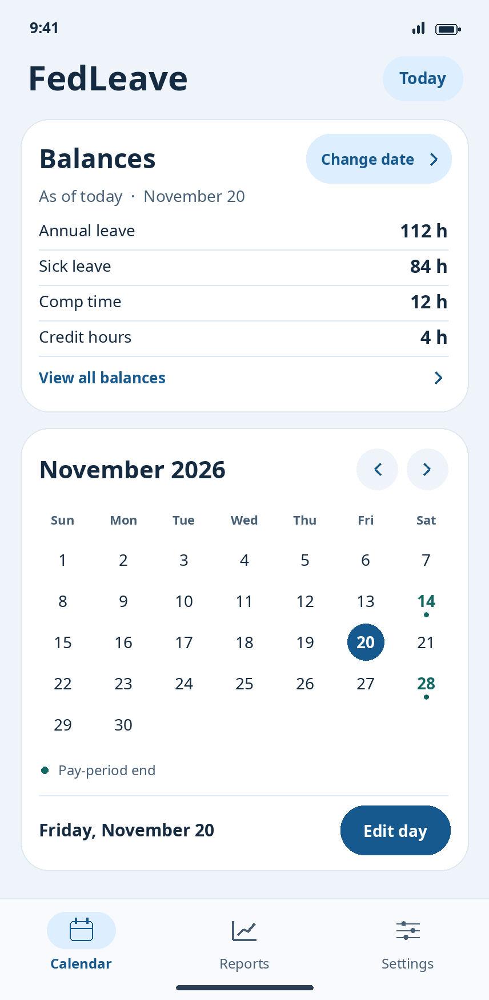

# Calendar balances

## User outcome

Calendar gives the user one **Balances** panel. They can see their position today, look back to an ordinary date, or look ahead to a pay-period closing date in the same place. Pay-period activity remains available beside the balance it explains. [Parity matrix](../parity.md) · [Acceptance cases](../testPlan.md#calendar-acceptance-cases)

1. **Balances** shows the active date above the figures. In this concept, a short set of categories fits on the front window and **View all balances** opens the complete set for that same date.
2. **Change date** in the panel opens the balance date picker. The **Today** action at the top restores the current date and month.
3. The month grid marks pay-period ends with bold numerals and a dot. The legend explains the mark. The date picker will use the same marker and an accessible label.
4. The selected calendar day above **Edit day** is the date the user is preparing to edit. The date in the Balances heading is the cutoff used for the balance calculation.

This front-window sample uses fictional November data. Date picker, historical selection, period detail, projection, and unavailable-state annotations are the next visual deliverables for this flow in the Calendar screen milestone.

## Requirements

| ID | Android behavior |
| --- | --- |
| `CAL-BAL-01` | A fresh open of Calendar starts on the device's current local date. The panel reads **As of today** and shows the date and balances in hours. Follow the device's local date while Today is active. |
| `CAL-BAL-02` | **Change date** opens a calendar picker at the panel's current date. On selection and confirmation, update the panel's date and figures together. Dismissing the picker preserves both. |
| `CAL-BAL-03` | Mark a pay-period end from the stored schedule in the month grid and picker. Announce **Pay-period end** in the date's accessible label. Provide nearby period ends as quick choices with the date and period number. A selected end date shows that day's closing balance in the same panel. Period details provide the number, start and end dates, payday, and earned and used hours by category. Review the proposed collapsed disclosure in the screen milestone. |
| `CAL-BAL-04` | For a date later than today, show **Projected balance** and the exact selected date. Use the calculation for that day, with effective scheduled activity and accrued hours through that date. |
| `CAL-BAL-05` | **Today** restores the current month, active calendar day, and balance date. A fresh open also starts on today after a previous manual date choice. |
| `CAL-BAL-06` | Keep a balance result paired with the date it covers. If a requested date cannot be loaded, show it with an unavailable state and a retry or date-change action. Carry forward applicable warnings and show an unavailable category value as unavailable. A slow older request must never replace the result for the current selection. |
| `CAL-BAL-07` | Use the stored leave-year start and end dates to resolve the selected day. A January date can belong to the preceding leave year. Prompt from the current task when an intentional date request needs a missing current or future year. [Leave-year setup](ledger-and-leave-years.md#start-or-find-a-leave-year) |
| `CAL-NAV-01` | Browsing another month or selecting a calendar day for inspection and editing keeps the balance date selected in the panel. Selecting a date through **Change date** or using **Today** changes the balance cutoff. |

## Data and calculation rules

- Resolve dates as calendar dates in the device's time zone. The balance cutoff includes activity dated on that day. Use the desktop opening balances, effective transaction rules, accrual dates, and expiration rules. Existing-year views calculate from the local store without adding, changing, or deleting ledger entries. [Desktop dated balance calculation](../../../src/fedleave/commands/balances.py#L271) · [Ledger balance rules](../../../src/fedleave/ledger.py#L186)
- Use the stored pay-period ending date as the balance cutoff for a closing balance. Pay date and accrual date are separate schedule fields. Closing balance equals the dated balance for that end date when calculated from the same data. Period earned and used totals cover the whole period and follow the desktop activity rules. [Month period calculations](../../../src/fedleave/commands/balances.py#L144) · [Schedule fields](../../../src/fedleave/payperiods.py#L43)
- A future dated balance uses the same result as a desktop lookup for that date. Label year-end **Use or Lose** with its own forecast horizon. Link from relevant balances to the lot and parental details. [Forecast and expiration requirements](ledger-and-leave-years.md#accrual-caps-and-expiration) · [Parental requirements](ledger-and-leave-years.md#paid-parental-leave-and-fmla) · [Desktop dated and projected month fields](../../../src/fedleave/commands/balances.py#L655)

## Screen states to annotate

| Screen or state ID | Key visual or interaction |
| --- | --- |
| `CALENDAR-MONTH` | Current month, previous and next actions, selected editing day, and separate markers for pay-period end and payday. |
| `BALANCES-TODAY` | One panel with today's date, category values, **Change date**, and the **Today** reset action. |
| `BALANCE-DATE-PICKER` | Date grid with the current selection, ordinary days, marked pay-period ends, nearby period shortcuts, and cancellation. |
| `BALANCES-DATED` | Selected historical date, balances and warning area, with the same controls as Today. |
| `BALANCES-PERIOD` | Closing date and the same balance values, plus the collapsed and expanded period activity. |
| `BALANCES-PROJECTED` | The projected label and exact future date, including how it combines with an end-of-period selection. |
| `BALANCES-UNAVAILABLE` | Requested date, missing data or read error, and recovery actions. |

## Decisions for later milestones

- Annotate the selected date and return path for missing-year setup opened from a future balance lookup or edit. [Leave-year setup](ledger-and-leave-years.md#start-or-find-a-leave-year)
- Review the number of quick period choices, the period-detail placement, category ordering and zero display, and how the full balance list fits on a compact phone.
