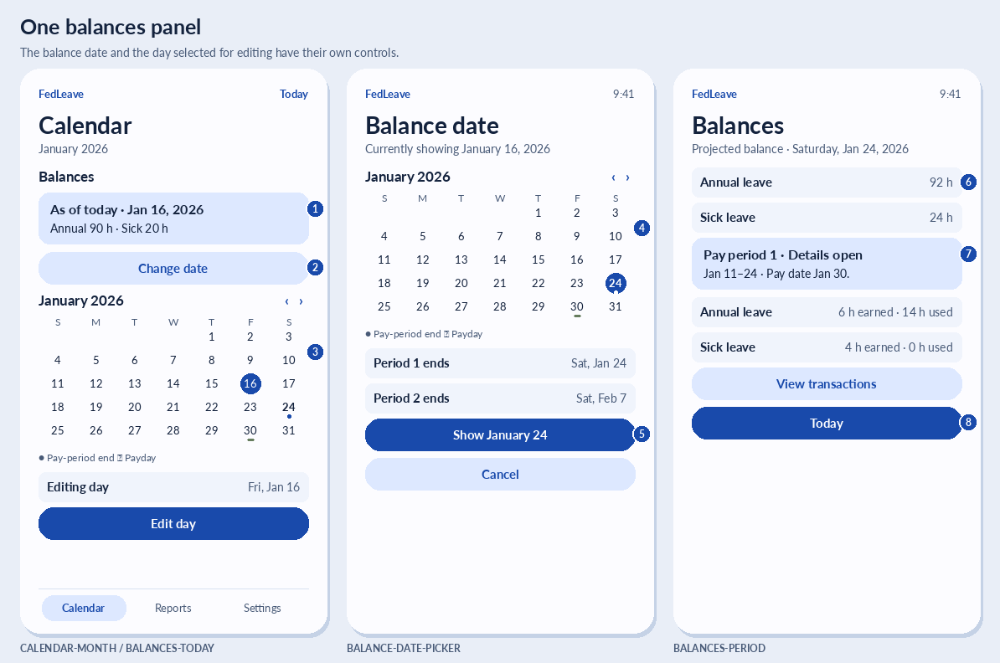
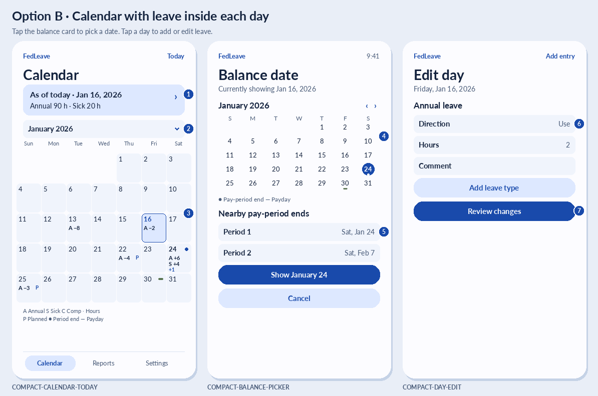
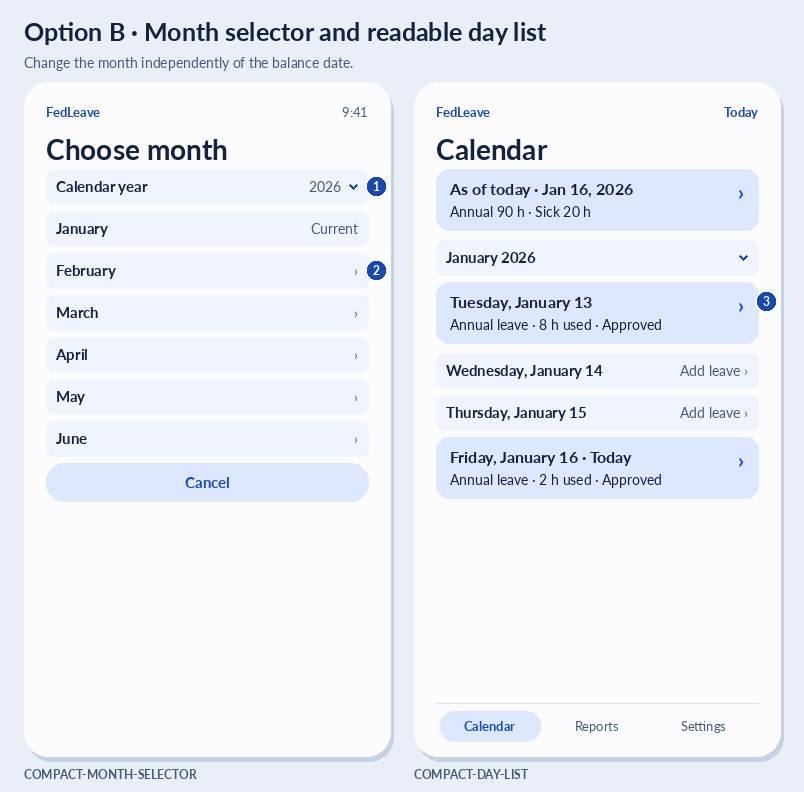

# Choose the Android Calendar layout

**Decision needed. Choose Option A or Option B for the Android main screen.** The choice is open. Both designs open on the same Today balance at the top, offer a date or pay-period end as the balance cutoff, and keep that cutoff independent of the month or day being edited.

| | Option A · Separate controls | Option B · Activity inside each day |
| --- | --- | --- |
| Change the balance date | Use the labeled **Change date** button below the balance. | Tap the entire balance card. A chevron signals that it opens the date and pay-period picker. |
| Scan the month | The grid emphasizes dates and pay-period marks. | Day cells also show short, signed amounts. The grid uses more of the available width and height. |
| Add or edit leave | Select a day, then use the separate **Edit day** section. | Tap the entire day cell to open the editor. A day with no entries opens the same editor ready to add one. |
| Change the displayed month | Use the month-navigation controls. | Tap the month and year to open a compact month selector. |
| Review on a phone | Labeled controls leave more room for readable text. | Daily activity is quicker to scan when the cell text is legible. On very narrow screens or with large text, use the full-width day list. |

## Option A · Separate controls

See the [original Calendar annotations](calendar-screens.md#calendar-date-picker-and-period-detail) for the control labels and positions.

## Option B · Activity inside each day

| Callout | What happens |
| --- | --- |
| 1 | Tap anywhere on the balance card to open the balance picker. TalkBack announces the date and amounts and labels the card action **Change balance date**. |
| 2 | Tap the month and year to open the month selector. The month selection only changes the displayed calendar. |
| 3 | Tap a day cell to edit its leave or add an entry. The day number and pay-period mark stay visible. A minus sign shows hours used, a plus sign shows hours earned, and **P** marks a planned entry. The day announces its date, category, amounts, status and any schedule markers. |
| 4–5 | Choose an ordinary date in the picker or a nearby pay-period end. Confirm to update the balance card on the main screen. Back or Cancel preserves the previous result. |
| 6–7 | The editor opens on the tapped date with full labels and exact hours. **Review changes** uses the existing save review. Saving refreshes the calendar and recalculates the balance at its existing cutoff. |

The sample shows annual and sick accruals on January 24 with automatic accrual display enabled. It adds one fictional comp entry on that future date to demonstrate overflow. The grid shows at most two activity lines per cell and uses **+1** to indicate one more. Tap the day to view every entry. At normal text size on a narrow phone, verify that the signs and decimals stay readable and that each day is easy to tap. If there is insufficient width for seven 48 dp targets, or the system font size makes the contents unreadable, show the full-width day list. In that list every date remains available for editing, including dates with zero entries.

| Callout | What happens |
| --- | --- |
| 1–2 | Set the calendar year and choose a month. The list scrolls to all twelve months. A month change preserves the selected balance date. |
| 3 | The day list spells out activity. Tap a row with activity to edit it or an empty date to add leave. The balance card and month selector remain in the same positions. |

## How to decide

Compare the first panel of each board at roughly the width of your phone. Try locating two amounts on a busy day, then imagine choosing a pay-period end and adding leave to an empty day. The owner choice is pending at [implementation milestone I05](implementation-milestones.md#draft-decisions-for-owner-review). If Option B is chosen, test the dense month grid and its day-list fallback on a compact handset before finalizing it.

Rebuild the Option B images with `python android/specficaiton/mockups/render.py android/specficaiton/mockups/calendar-compact.json`. [Editable Option B source](../mockups/calendar-compact.json)
