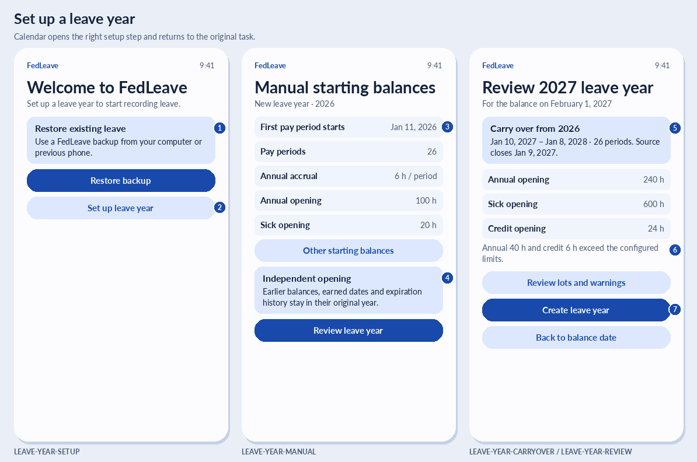
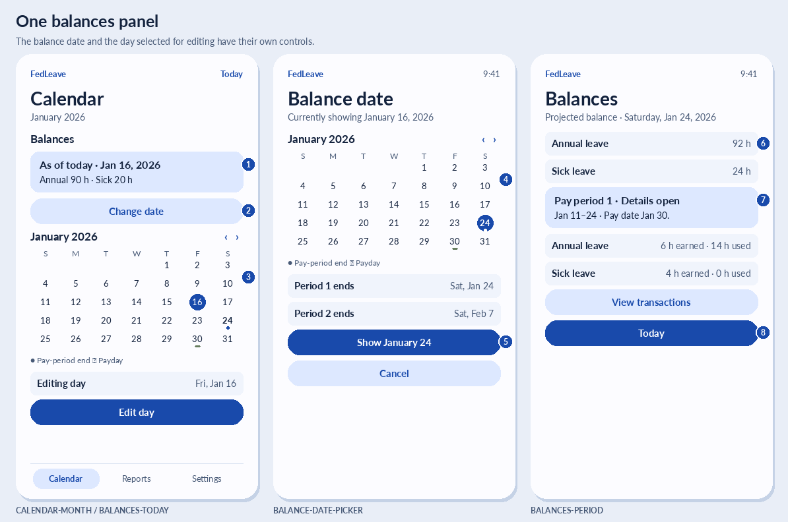
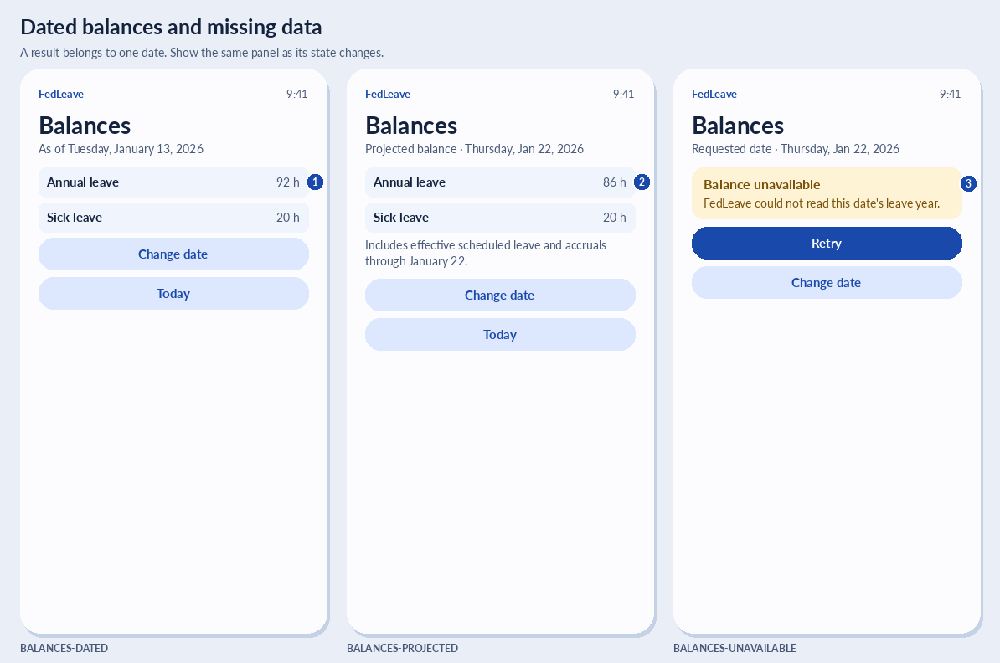
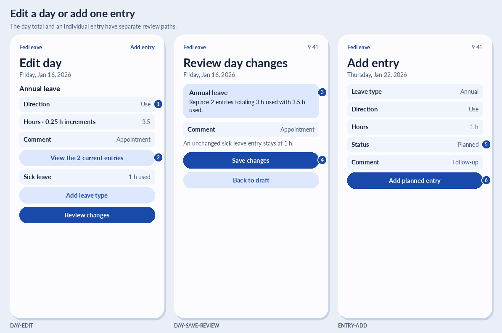
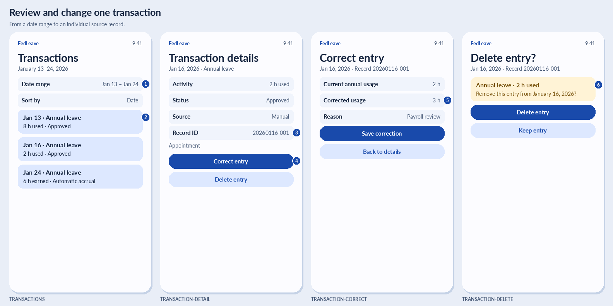

# Phone navigation and Calendar screens

The main Calendar board below shows **Option A**. The owner still needs to choose between this layout and the alternative. [Compare both layouts](calendar-layout-options.md)

Use three persistent destinations for familiar tasks. **Calendar** opens first and keeps daily work nearby. **Reports** owns analytical views and month previews. **Settings** owns preferences, data maintenance and help. Opening a detailed task or system sheet retains the calling destination. Use the Calendar, Reports and Settings labels alongside any icons. The main screens use a fixed blue Material 3 palette for the specification. Implementation also needs a coordinated dark palette, 48 dp touch targets, Android text scaling, keyboard-safe layouts and TalkBack labels. Numbers on the mockups are specification annotations.

[Calendar behavior](calendar-balances.md) · [Ledger and leave-year behavior](ledger-and-leave-years.md) · [Acceptance plan](../testPlan.md#calendar-acceptance-cases)

## First use and leave-year setup

| Callout | Interaction and states | Requirements |
| --- | --- | --- |
| 1–2 | First launch offers restore or a new setup. Return from the system picker or a cancelled setup to this screen with the prior choices visible. | `CAL-YEAR-01`, `DATA-RESTORE-01` |
| 3–4 | Manual setup presents the selected calendar dates, accrual and initial hours. Keep supported additional balances under one disclosure. Validate the date range and increments before review. Manual mode explains that earlier balances and special earning history stay in their original ledger. | `CAL-YEAR-01`, `YEAR-MAN-01` |
| 5–7 | Carryover review names the originating task and shows source close, proposed schedule, category quantities and reductions. Lot details and warnings are available before creating. A stale preview reopens review. Cancelling returns to the original task. Manual review uses the same confirmation layout with its own opening amounts and no linked source. | `CAL-YEAR-01`, `YEAR-CARRY-01` |

## Calendar, date picker, and period detail

| Callout | Interaction and states | Requirements |
| --- | --- | --- |
| 1–3 | Calendar opens on Today. The balance card can show more categories without navigating to a different calculation. **Change date** opens the balance picker. The grid's selected day below is for editing. Month navigation and editing preserve the balance date. | `CAL-BAL-01`, `CAL-BAL-02`, `CAL-NAV-01` |
| 4–5 | Mark pay-period end with bold numerals, a dot and spoken text. A payday has a distinct accessible label. The quick choices below the grid include nearby ends. Confirm sends the selected date, which is resolved against the stored schedule. | `CAL-BAL-02`, `CAL-BAL-03`, `CAL-BAL-07` |
| 6–8 | In the same panel, show the closing balance and expandable period activity. The third mockup enlarges that panel for review. Keep the cutoffs and payday visible, and open history with the period range preset. **Today** resets the date and active month. | `CAL-BAL-03`, `CAL-BAL-04`, `CAL-BAL-05`, `CAL-HISTORY-01` |

## Other balance states

| Callout | Interaction and states | Requirements |
| --- | --- | --- |
| 1 | Show the precise date and matching values after selection. Back out of a cancelled picker to the previous result. | `CAL-BAL-02`, `CAL-BAL-07` |
| 2 | Label a future result **Projected balance** and show the date. A fresh Calendar view and the Today action restore Today. | `CAL-BAL-04`, `CAL-BAL-05` |
| 3 | Keep the requested date and display retry or change-date controls. An uncovered Today also offers setup. Surface a conflict or unreadable data as an unavailable balance. | `CAL-BAL-06`, `CAL-YEAR-01` |

## Add and review leave

| Callout | Interaction and states | Requirements |
| --- | --- | --- |
| 1–2 | Prefill the day, direction, valid increments and existing comments. Offer Add leave type. Display individual entries when a total represents multiple records. Use native numeric entry and keep form controls visible above the keyboard. | `CAL-DAY-01`, `PARENT-01` |
| 3–4 | Review changed categories and comments and identify the records being replaced. Back keeps the draft. Show mismatched amount, conflict or save failure inline and keep the copy of the draft editable. | `CAL-DAY-01` |
| 5–6 | For a new individual record, choose date, category, direction, hours and status. Label future dates and display status in history. Overlapping PPL and FMLA usage has a [dedicated confirmation](data-settings-screens.md#ppl-windows-and-fmla-tracking). | `CAL-DAY-02`, `PARENT-02` |

## History and corrections

| Callout | Interaction and states | Requirements |
| --- | --- | --- |
| 1–2 | Date-range controls include both boundary dates. Preserve date or sorting selection on Back. Report empty ranges, invalid inputs and unavailable ledgers separately. | `CAL-HISTORY-01` |
| 3–4 | Show the stored ID, source and full comment in details. Give each available action an accessible label. Generated and dependent records link to the appropriate source or maintenance view. | `CAL-HISTORY-01`, `CAL-TX-01` |
| 5–6 | Correcting and deleting use separate review confirmations. Either path retains the original list filters on return. | `CAL-TX-01` |

Rebuild these images with `python android/specficaiton/mockups/render.py android/specficaiton/mockups/calendar.json` using Pillow and Lato. The original front-window concept remains available for palette review. [Original Calendar concept](../mockups/calendar-front-window.png)
