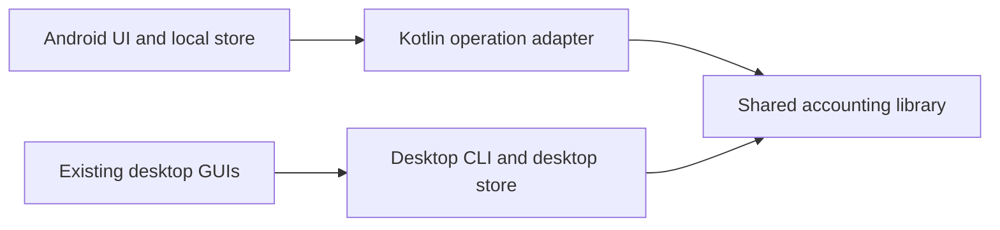

# Shared accounting core and compatibility

## Recommendation

Build the phone UI in Kotlin and Jetpack Compose. Keep the desktop CLI, and extract a small importable Python accounting library from its existing implementation. The Android app should call this library in process through a typed Kotlin adapter. Pilot Chaquopy for that bridge. The existing CLI keeps its commands, arguments, output and error contracts and becomes another adapter over the shared operations. Linux and Windows GUI users continue to use their installed desktop applications. [Current dependency boundaries](../../../docs/ARCHITECTURE.md#dependency-direction) · [Chaquopy Gradle integration](https://chaquo.com/chaquopy/doc/current/android.html)

This preserves one implementation for hard-to-reproduce behavior such as linked-year recalculation, expiration allocation, and overlapping PPL windows. Embedding Python adds a runtime and native-dependency packaging work. The first implementation milestone is a small build and parity experiment. Technical approval of the bridge depends on that experiment.

| Approach | Consequence |
| --- | --- |
| Native Compose and shared Python library | Reuses desktop rules and isolates the Android bridge behind one interface. Adds a Python runtime and requires native wheel and ABI verification. Recommended first experiment. |
| Kotlin accounting engine with the same interchange contracts | Fits the native stack. Maintaining an active Python reference and a separate engine would require two implementations of every rule and strict release-gated fixtures. Reconsider if the bridge fails. |
| Replace the Python engine across desktop and Android at the same time | Can eventually share a different implementation, but changes established desktop packaging and risks a larger compatibility migration. A separate project decision would be required. |

## Responsibilities and data flow

- **Core.** Accept an explicit snapshot, configuration, operation inputs and local date. Own the canonical definitions for transaction eligibility, accrual, leave-year boundaries, category policy, lots, carryover, parental windows and reporting inputs. Return computed results, structured validation issues and validated proposed JSON changes. Preserve unknown additive data for compatible later writes. Initial extraction should group cohesive functions already present in the repository. [Source map](../../../docs/ARCHITECTURE.md#source-map) · [Canonical transaction effects](../../../src/fedleave/transaction_effects.py)
- **Android.** Kotlin owns view state, lifecycle, file picker and Sharesheet, app-private reads and durable writes, chart rendering, clock injection, and platform configuration. Save progress and errors in UI state. Run bridge and I/O calls off the UI thread. Keep a single writer and avoid returning obsolete async results. A plain typed request into the library can serialize validated data to JSON internally. A comment stays a string through parsing, review, storage and display. Terminal processes and shell command construction are outside this Android path.
- **Desktop.** Existing process entry points, packaged companion names, display policies, text and JSON modes, and datastore behavior remain the compatibility baseline. CLI adapters keep command-specific presentation and invocation locking. Extract operation implementations behind those adapters before moving callers. GUI reports can reuse canonical read snapshots and chart data without pulling Qt into the core. [Desktop compatibility policy](../../../docs/ARCHITECTURE.md#compatibility-policy)
- **Read and write boundary.** Pass a read-only snapshot to queries. Recompute derived rows on copies. A preview returns a plan and identity for the source state and policy. Confirm validates the same state under the datastore writer before applying. Where desktop functions currently load file paths or use a lock, extract snapshot-based computation and keep platform storage adapters responsible for reading and publishing changes. [Device storage contract](device-storage.md#write-and-recovery-model)
- **Library inputs and outputs.** Use finite hour values, actual leave-year identifiers, ISO calendar dates and stable transaction IDs within a year. Distinguish a valid zero from an unavailable value. Keep the active cutoff as a date independent of UI locale or timestamp parsing. Preserve machine-readable category, status, date, provenance, warning and conflict codes. Map these to user labels in the UI. Log only operation context and safe error codes in normal diagnostics.

| Operations | Inputs | Returned contract |
| --- | --- | --- |
| Calendar, dated balance, period detail, forecast | Snapshot, year or requested date, clock, selected schedule | Date-tagged amounts, period metadata, activity, projections and warnings. |
| Add, set day, correct, delete, adjust, accrual edit | Existing records, selected IDs and changes, explicit user decisions where required | Validation result and proposed canonical ledger with precise target and changed IDs. |
| Manual or linked setup, carryover and recovery planning | Schedule, configuration, relevant linked ledger snapshots, reviewed fingerprint | New or revised ledger proposal with dates, amounts, affected years, warnings, provenance and conflicts. Store recovery remains adapter-owned. |
| Expirations, PPL/FMLA, analysis, chart and month data | Resolved read-only snapshot and selected filters | Exact values, cutoffs, warnings, lot/window identity and contributing rows. |
| Backup restore and WMS import validation | Parsed archive or report and candidate merged store | Complete validation and a proposal that can be reviewed and applied once. |

## Proof-of-concept exit conditions

1. Start with a minimal Kotlin/Compose screen, the smallest callable subset of the Python core and one dated balance. Exclude terminal adapters, MCP, Qt and desktop chart packages from the Android build dependency graph. Inspect imports, including Python package initialization, so those dependencies are not loaded indirectly.
2. Pin a tested set of Android Gradle Plugin, Python, Gradle and bridge versions. Document the corresponding minimum SDK. Chaquopy's published table supports API 24 or newer for the current 17.x releases. A provisional Android support floor is specified in the developer setup milestone and should be tested along with the successful bridge configuration. [Chaquopy compatibility table](https://chaquo.com/chaquopy/doc/current/versions.html)
3. Build for an ARM64 phone and the emulator architecture used for development. Verify the core and all native wheels, especially Pydantic's compiled core, on those targets. Dependency availability varies with the Python version and ABI. Record the resulting app size, cold startup time and median dated lookup time using the same fixture. Confirm signed bundle packaging and native 16 KB page-size compatibility. Test offline. [Bridge dependency requirements](https://chaquo.com/chaquopy/doc/current/android.html#requirements) · [Android 64-bit guidance](https://developer.android.com/google/play/requirements/64-bit) · [Android 16 KB support](https://developer.android.com/guide/practices/page-sizes)
4. Compare the prototype's Calendar, accrual, carryover and PPL/FMLA results with the golden fixtures. Keep the existing Linux and Windows GUI/CLI entry points compatible before migrating more logic. If the build needs fragile private wheels or parity fails, record the failing case and compare the cost of fixing it with a Kotlin port under the same fixture contract.

## Parity fixtures

Use the [acceptance cases](../testPlan.md) as names and human-readable behavior. Implementation adds a versioned fixture manifest with `case_id`, desktop source revision, injected local date and calendar zone, a synthetic input store, a typed request, expected output, and any expected stored change. The source belongs in Git. Expected results must reference the pinned desktop behavior or identify a reviewed Android improvement explicitly.

| Fixture family | Minimum exact comparisons |
| --- | --- |
| Calendar and accrual | Today 90 h annual and 20 h sick in `T-CAL-BAL-01`, Jan 24 closing 92 h and 24 h, older January year ownership, effective dates, 27-period schedule and changed versus unchanged rows. |
| Edits and status | Day replacement IDs and exact comment, individual correction and deletion, inactive rows, repeated adjustments, and unchanged generated rows where Android deliberately protects them. |
| Opening and linked years | Manual ancestry boundary, caps of 240 h and 24 h in the carryover fixture, multi-year source ID and deadlines, stale preview, missing source, reconciliation and interruption. |
| Lots and parental | Deadline-inclusive eligibility, split lot allocation, grants, contributions, first ineligible dates, incomplete FMLA history, zero-hour overlapping windows and tracked absence. |
| Reports | Dated as-of and dedicated year-end forecast, cumulative use versus dates, selected category values and source entries, February 29 comparison mapping, geometry-independent chart data. |
| On-disk compatibility | Schema version, keys, types, ledger IDs, user settings and cache payloads before and after restores, plus disk recovery at failure points. |

Compare dates, IDs, enumeration values, errors and warning codes exactly. Verify finite decimal-hour results using the existing domain tolerance where fractional arithmetic requires it. Canonicalize JSON object key order for semantic comparisons. Keep raw byte hashes for read-only, cancelled and failed mutations. Supply a clock and controllable generated timestamps for audit fields, with repeated input cases to verify stable identities. A phone and the unmodified reference desktop GUI are separately required for end-to-end compatibility.
