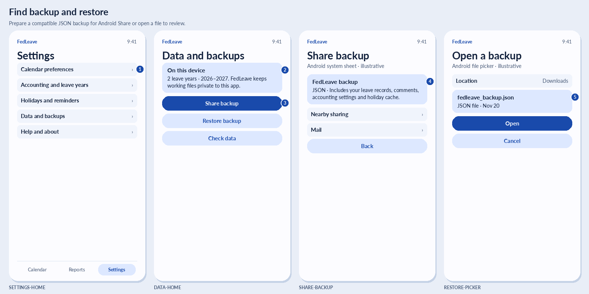
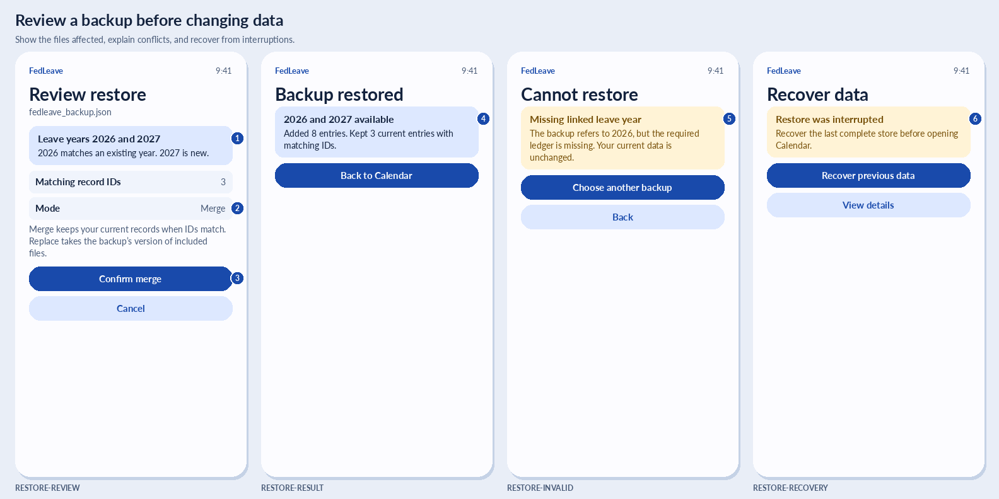
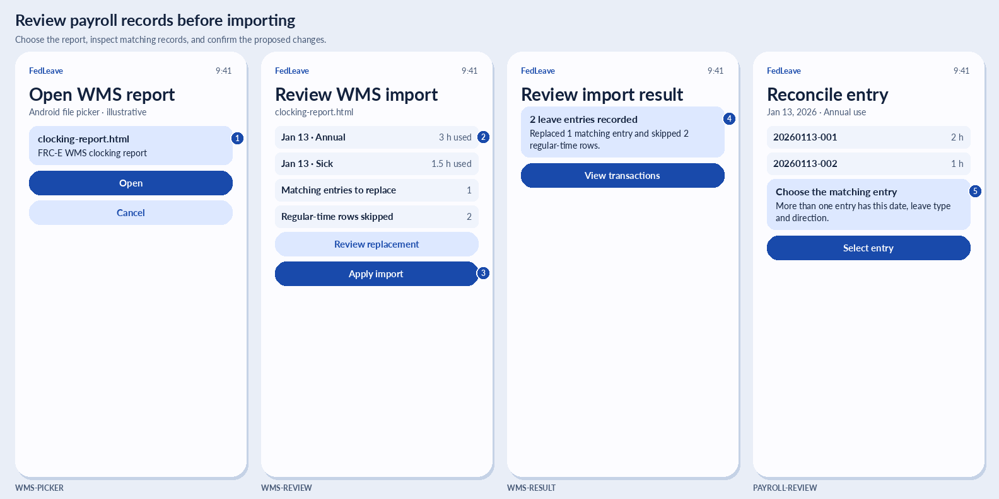
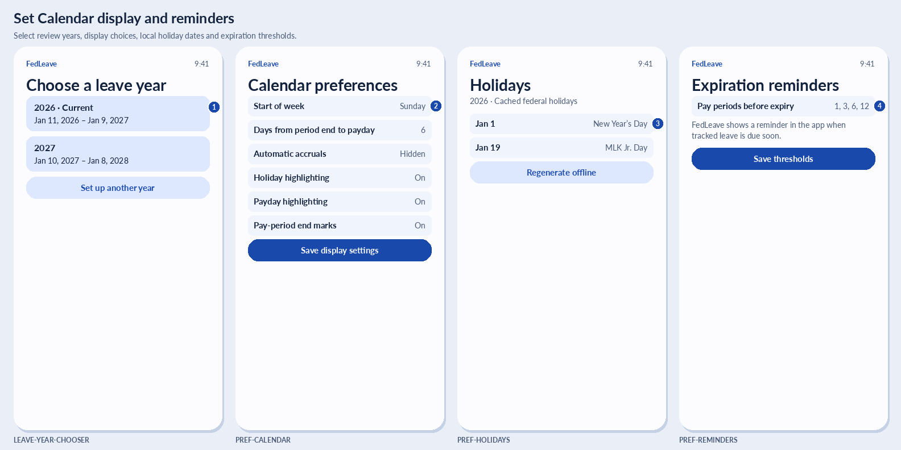
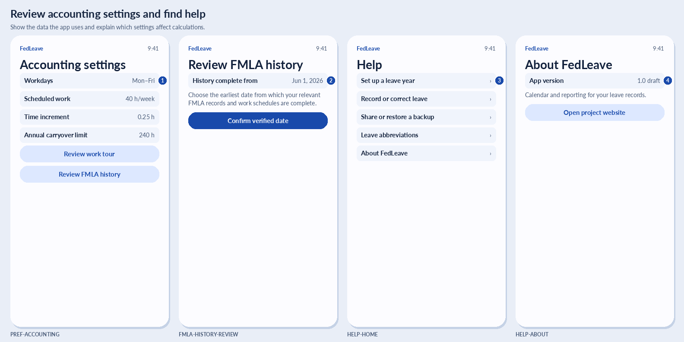
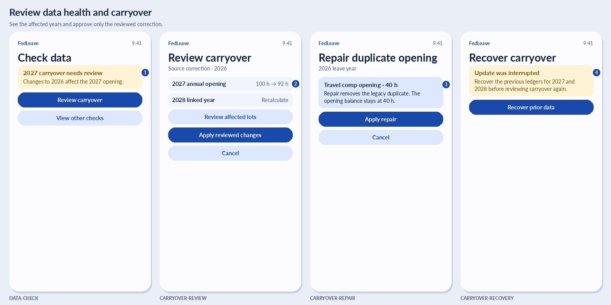
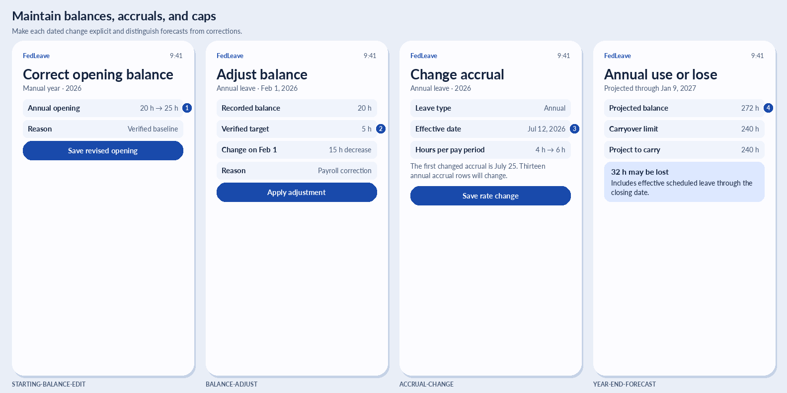
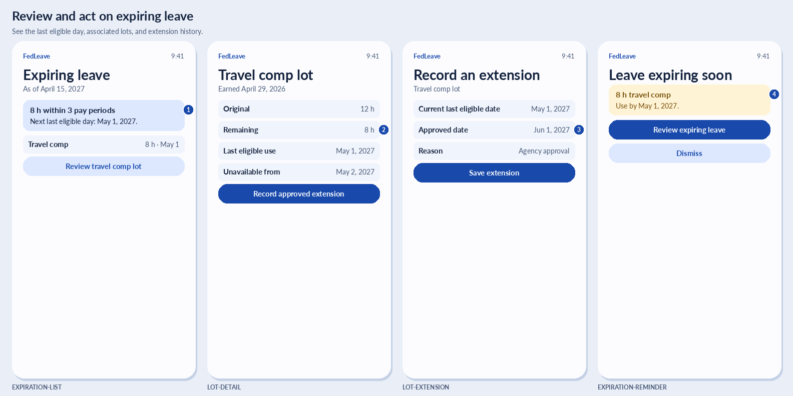
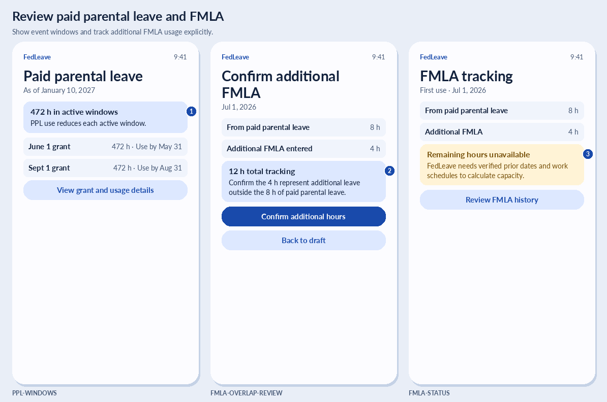

# Data, maintenance, and settings screens

Settings groups week and display preferences, leave-year maintenance, holiday and reminder controls, data and backups, and help. Routes from Calendar or Reports open the relevant detail and return to the calling task. Show record changes before approving them. Device-owned pickers and Sharesheets are illustrative in the mockups.

[Data and preference requirements](reports-data-and-preferences.md#data-and-maintenance) · [Ledger requirements](ledger-and-leave-years.md) · [Acceptance cases](../testPlan.md#data-and-preferences-acceptance)

## Backups and system file picker

| Callout | Interaction and states | Requirements |
| --- | --- | --- |
| 1–3 | Open Settings, then Data and backups. Show which years are on this phone and make Share backup and Restore backup easy to find. Shared backups include ledger data and comments. Report preparation status and allow retry after error. | `DATA-SHARE-01`, `DATA-RESTORE-01` |
| 4–5 | Hand the prepared backup to Android Share. For restore open Android's file picker. Dismissing either returns to the caller, with the active store intact. | `DATA-SHARE-01`, `DATA-RESTORE-01` |

## Restore review and recovery

| Callout | Interaction and states | Requirements |
| --- | --- | --- |
| 1–3 | Show the source filename, candidate years, record collisions and affected settings and caches for the selected mode. A failed validation disables confirmation. Confirm changes only from a current, complete preview. | `DATA-RESTORE-01` |
| 4–6 | Show applied or retained record counts on success, a cause and another-picker action on rejection, and a recovery action after interruption. Restore from first launch returns to Calendar after success. Recovery takes priority over displaying incomplete data. | `DATA-RESTORE-01` |

## WMS import and manual payroll review

| Callout | Interaction and states | Requirements |
| --- | --- | --- |
| 1–3 | Select a report file through Android, parse in private storage, and review mapped hours, matched replacements and skipped rows. Ask for leave-year setup when needed. A rejected report identifies the row or mapping issue in app terms. | `DATA-WMS-01`, `CAL-YEAR-01` |
| 4–5 | Return from the import result to the affected dates. The manual payroll action opens a selector when multiple rows match, then shows the selected record, revised hours and reason before applying. | `DATA-WMS-01`, `DATA-PAYROLL-01` |

## Calendar, holidays, and reminders

| Callout | Interaction and states | Requirements |
| --- | --- | --- |
| 1–2 | Show actual year bounds in the chooser. Apply Calendar display choices without changing calculation dates. Respect larger system fonts and retain period-end labels in the balance picker. | `PREF-YEAR-01`, `PREF-CAL-01` |
| 3–5 | List observed holiday dates and their cache source. Offer offline regeneration and a picker with import review. Preserve the readable cache if validation fails. Keep nonnegative, distinct reminder thresholds in pay periods. | `PREF-HOL-01`, `PREF-REM-01` |

## Accounting settings and help

| Callout | Interaction and states | Requirements |
| --- | --- | --- |
| 1–2 | Show accounting rules in use. Review changes that influence balances and verify a history start before displaying remaining FMLA hours as known. | `PREF-RULE-01`, `PARENT-02` |
| 3–4 | Group bundled help by user task, with a leave abbreviation list. About gives version and an external project link. | `HELP-01` |

## Data check, carryover and repair

| Callout | Interaction and states | Requirements |
| --- | --- | --- |
| 1–2 | Check data on demand and identify affected years. Review old and new openings, lots and missing-source conflicts before acknowledging a new result. A stale review reloads and reconfirms. | `DATA-VALIDATE-01`, `YEAR-REC-01` |
| 3–4 | Repair a known legacy mirror explicitly. Interrupted carryover updates open recovery before a new review or other ledger edit. | `DATA-REPAIR-01`, `YEAR-REC-01` |

## Opening balance, balance adjustment, and accrual

| Callout | Interaction and states | Requirements |
| --- | --- | --- |
| 1 | Compare old and revised opening in an independent year. A linked year routes to source or carryover review. | `YEAR-OPEN-01` |
| 2–3 | Select the date and input the intended adjustment or accrual rate. The accrual editor accepts annual or sick. Review the effective date, applicable hours, and reason. Keep draft on failure and show the new calculation after save. | `CAL-FORCE-01`, `YEAR-ACC-01` |
| 4 | Read the dedicated use-or-lose calculation with its forecast close, carryover cap and excess. It does not alter the data. | `YEAR-CAP-01` |

## Expiration and approved deadlines

| Callout | Interaction and states | Requirements |
| --- | --- | --- |
| 1–2 | Show upcoming hours and dates. The lot view adds source identity, original quantity, used hours or allocations, extension history and the first ineligible date. An empty list states there are no upcoming deadlines. | `EXP-01` |
| 3–4 | Record a permitted later approved deadline and reason. The urgency reminder deep-links to expiration details and observes local thresholds. | `EXP-01`, `EXP-02`, `PREF-REM-01` |

## PPL windows and FMLA tracking

| Callout | Interaction and states | Requirements |
| --- | --- | --- |
| 1 | Each grant and use is dated. Show the remaining allowance across active windows and the original deadlines. Expand to review scheduled, protected and lost hours. The [day editor](calendar-screens.md#add-and-review-leave) records the grants and usage. | `PARENT-01` |
| 2–3 | Ask separately about additional manual FMLA. Show derived and additional hours, confirmed or provisional date context, and availability or an explanation when records are incomplete. | `PARENT-02` |

Rebuild the images with `python android/specficaiton/mockups/render.py android/specficaiton/mockups/settings.json`.
