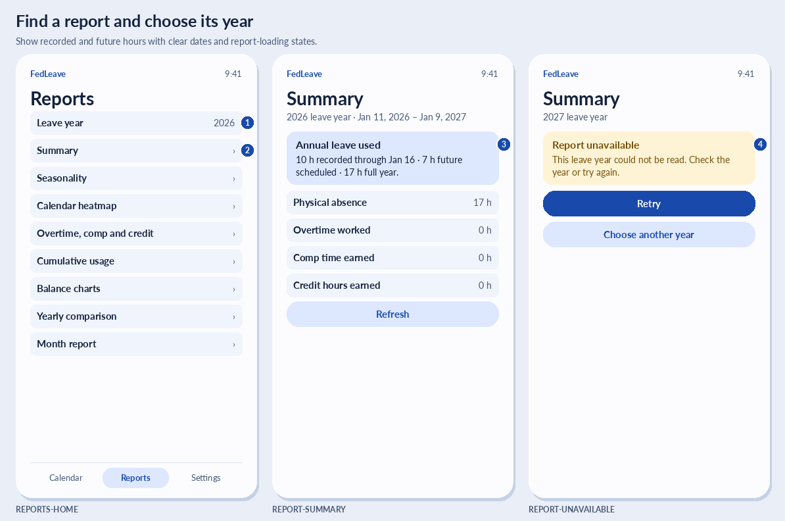
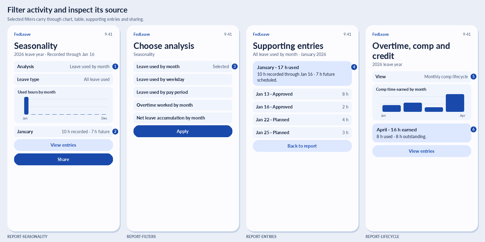
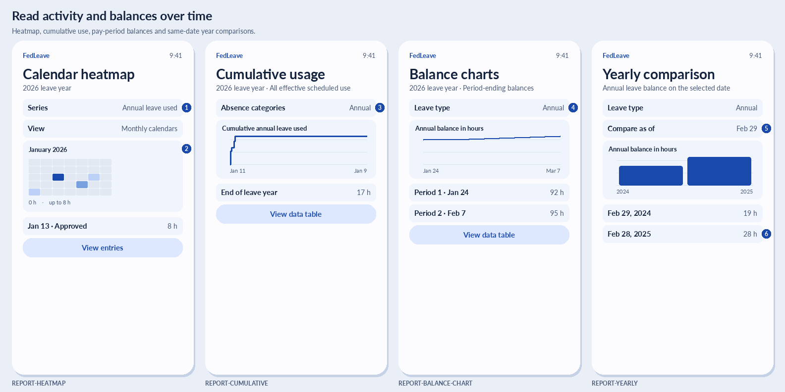
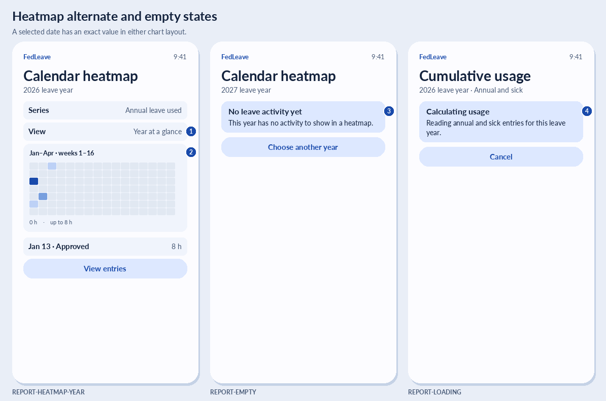
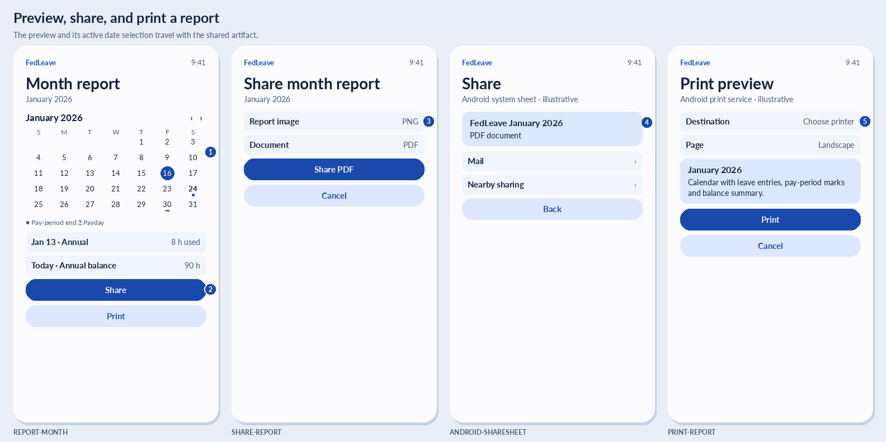

# Report screens and sharing

Reports is a phone destination with a year selector and report list. Keep interactive chart controls beside the result they affect. Open long tables and supporting entries as details. Read aloud the chart title, units, timeframe and selected value. Pair colors with labels or visual marks. System picker, share, and print UIs will vary with the phone.

[Report requirements](reports-data-and-preferences.md#reports) · [Acceptance cases](../testPlan.md#reports-acceptance)

## Reports list and summary

| Callout | Interaction and states | Requirements |
| --- | --- | --- |
| 1–2 | Choose a valid leave year, see its date range in each report, and open a report without changing Calendar's balance date. The phone list is scrollable at large text size. | `REP-SUM-01`, `PREF-YEAR-01` |
| 3–4 | Show recorded, scheduled, and full-year results where applicable. Link data-quality warnings to details. Refresh uses current local data. Show unreadability or incomplete history without inventing a numeric zero. | `REP-SUM-01` |

## Activity breakdowns and supporting entries

| Callout | Interaction and states | Requirements |
| --- | --- | --- |
| 1–3 | Analysis and Leave type drive the chart, exact table, and shared result. Filter sheets list supported category and activity choices. Disabled Leave type remains visible for overtime and net accumulation. Chart and row values identify recorded and scheduled amounts. | `REP-SEA-01`, `REP-SHARE-01` |
| 4 | Open **View entries** with date, source, status and hours matching the selected report row or cell. Back retains the original report filters and scroll position. | `REP-SEA-01`, `REP-HEAT-01`, `REP-LIFE-01`, `REP-CUM-01` |
| 5–6 | Use this selector layout for the seven lifecycle views. Keep tables handy for the summary, lots, allocation and expiration performance. Empty or incomplete queries keep the view label and either explain the empty set or show unavailable values. | `REP-LIFE-01` |

## Heatmap, usage, and balance charts

| Callout | Interaction and states | Requirements |
| --- | --- | --- |
| 1–2 | Heatmap offers monthly grids and the year-at-a-glance strip. Read exact cell dates and values on tap and TalkBack. | `REP-HEAT-01` |
| 3 | List or select multiple absence categories. View exact cumulative daily entries. Preserve the whole-year extent and show the time context. | `REP-CUM-01` |
| 4 | Choose from the six balance series. A period point label includes its end date and balance. The exact table is navigable independently of the chart. | `REP-CHART-01` |
| 5–6 | Keep the selected month and day visible and list the date actually mapped into each comparison year. Provide the seven supported category choices. | `REP-YOY-01` |

| Callout | Interaction and states | Requirements |
| --- | --- | --- |
| 1–2 | The full-year strip scrolls horizontally on compact phones with a spoken week and date. The example shows its first viewport. Both layouts provide the same data and details. | `REP-HEAT-01` |
| 3–4 | Distinguish no activity from a read problem and offer another year. Cancel a pending calculation without clearing the selected categories. Older results cannot overwrite the current selection. | `REP-SUM-01`, `REP-HEAT-01`, `REP-CUM-01` |

## Month preview, Share, and Print

| Callout | Interaction and states | Requirements |
| --- | --- | --- |
| 1–2 | Show a readable month preview with the selected month, leave records and balance context. Keep **Share** and **Print** recognizable. | `REP-MONTH-01` |
| 3–4 | Choose a supported format and hand off the rendered report to Android. Report preparation failure leaves its preview open and offers Retry. Back or cancellation returns to the report and its current filters. | `REP-SHARE-01`, `REP-MONTH-01` |
| 5 | Print invokes the system service with the current report and applicable layout. A missing printer and cancellation return to the preview. | `REP-MONTH-01`, `REP-SHARE-01` |

Rebuild the images with `python android/specficaiton/mockups/render.py android/specficaiton/mockups/reports.json`. The chart examples are fictional records and fixed-date specification fixtures.
