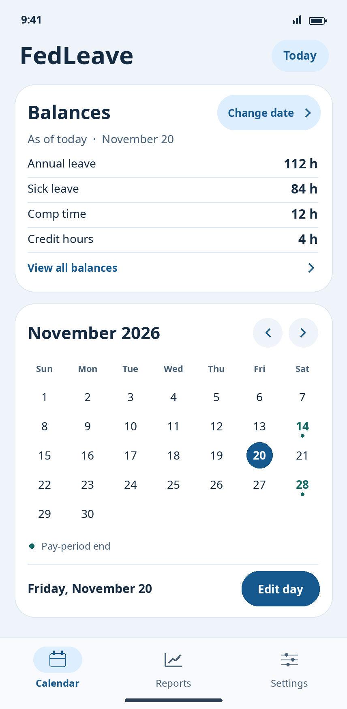

# Plan for writing the FedLeave Android specification

Use this plan to turn the existing FedLeave desktop product into a detailed, reviewable specification for an Android phone app. The specification will define the behavior, annotate the screens, settle the technical decisions, and identify the tests that prove parity. Review and approve this plan before drafting the specification.

## What we want to build

- A phone-friendly FedLeave app with the same leave-accounting behavior and a mobile way to perform every workflow in scope for the first release.
- Private on-device storage for leave records, comments, settings, and working files. Use the existing FedLeave JSON formats so the phone and the Linux and Windows desktop apps can exchange backups. Ordinary use should work offline.
- **Share** for supported graphs, report images, and backups. Open the Android Sharesheet so the user can choose a compatible app, such as messaging or email.
- A consistent, polished interface that is comfortable on a small screen. Each function in scope must have an annotated screen or an annotated flow that shows how the user performs it.

### Organize the eventual specification

Use a short `specification.md` as an index with requirements by topic under `sections/`. Keep the parity matrix in `parity.md`, annotated images and their editable sources under `mockups/`, test cases in `testPlan.md`, and working notes under `passdowns/`. These are proposed deliverables for future sessions.

| Chapter | What to write |
| --- | --- |
| Product and scope | Who uses FedLeave, the most common phone tasks, supported devices, offline expectations, and the decisions needed for parity. |
| Feature parity | A row for each existing function, its proposed phone workflow or other disposition, and the evidence needed to verify it. |
| Navigation and screens | A navigation map, annotated screen images, interaction rules, and accessibility and visual design standards. |
| Rules and architecture | The calculation contract, how the Android app and desktop CLI use core logic, and the cases that must produce identical results. |
| On-device data and sharing | Desktop-compatible JSON storage and backups, Android sharing, import and restore, upgrades, privacy, and recovery. |
| Testing and Google Play | Beginner setup, automated and manual testing, release checks, publisher account steps, and the production submission plan. |
| Implementation milestones | Small, testable increments with dependencies, acceptance checks, and a passdown at the end of each usage window. |

## Start with the desktop app as the reference

Pin the source revision and published build used to establish parity. Use the revision recorded in `installers/BUILD.txt` when starting the inventory. Consult the README, desktop menus, CLI help and entry points, behavior tests, and relevant open and closed GitHub issues. Mark whether each issue describes shipped behavior, a new Android requirement, or a deferred item. Verify what exists in the reference build when the issue or changelog describes an older feature. [FedLeave README](../../README.md) · [Architecture](../../docs/ARCHITECTURE.md) · [Build identity](../../installers/BUILD.txt) · [GitHub issue history](https://github.com/joshua-guthrie/fedleave/issues?q=is%3Aissue)

### GitHub issues reflected in this draft

The five open issues reviewed on November 20, 2026 inform the first Android release and this plan's sample screen.

| Issue | Direction for the plan |
| --- | --- |
| [#147](https://github.com/joshua-guthrie/fedleave/issues/147) | Defer the What-if Planner beyond the first Android release. Record it as a parity exception. |
| [#148](https://github.com/joshua-guthrie/fedleave/issues/148) | Use **Share** and Android's Sharesheet for graphs, images, and backups. |
| [#149](https://github.com/joshua-guthrie/fedleave/issues/149) | Have Android handle missing leave years for the current date and actions in a future year. Define when to confirm and how to initialize the year. |
| [#150](https://github.com/joshua-guthrie/fedleave/issues/150) | Use the front-window sample below to review the layout and Material 3 style before writing the specification. |
| [#151](https://github.com/joshua-guthrie/fedleave/issues/151) | Exclude MCP and AI interfaces from Android. Keep desktop CLI commands and references entirely out of Android's UI and user help. |

Give each function a stable ID. Use these columns in the parity matrix.

| Function ID | Desktop entry point and observed behavior | Android disposition | Screen or flow ID | Acceptance test ID | Open decision |
| --- | --- | --- | --- | --- | --- |
| Example `CAL-01` | Calendar **Edit Day** changes the selected date using the daily ledger rules | Phone workflow | `DAY-EDIT` | `T-CAL-01` | Choose how to show an edit preview in the draft spec |

Default each existing user capability to a **phone workflow** or **Android equivalent** within the agreed scope. Inventory desktop commands to find underlying workflows and rules worth carrying forward. Keep developer-facing desktop interfaces separate from those capabilities. Examine platform-specific settings such as choosing a desktop backend or checking desktop installer updates. Record approved exceptions, including the deferred Planner and desktop integrations, in the parity matrix.

Break the first inventory into groups that can be finished independently.

- **Calendar and ledger.** Today, month and day navigation, pay days and pay periods, balances, daily entries and free-text comments, transaction history, planned leave, corrections and voids, and force balance.
- **Leave-year rules.** Manual starting balances, carryover and reconciliation, accrual schedules and changes, caps, expirations and use-or-lose, lot allocation, all supported leave categories, and paid parental leave and FMLA.
- **Reports.** Analytics sections and their filters, source transaction drill-downs, yearly charts and comparisons, and month report graphics. Record the desktop What-if Planner as deferred for the first Android release.
- **Import, sharing, and settings.** Compatible FedLeave backup and restore, WMS HTML import, holiday cache and calendar sources, report and backup sharing, presentation preferences, help, and about. Check which report formats the desktop actually makes available.

## Design the phone screens

Start with a navigation sketch for the most frequent jobs. Compare candidates such as **Today**, **Calendar**, and **Reports**, with less frequent settings and maintenance actions grouped separately. Walk through a few realistic tasks before choosing a structure. Check how quickly a new user can see a balance, enter leave, correct an entry, share a chart, and share a backup.

Mock up a single **Balances** panel for Android Calendar. A fresh open shows **As of today** with the date. **Change date** opens the calendar picker, where pay-period end dates are bold and labeled. Try nearby period ends as quick choices. Any selected date updates the same panel, and **Today** resets it. Label future balances as projections. Explore an expandable section for the selected pay period's earned and used hours. Annotate these states and write acceptance checks for the default, an ordinary day, a pay-period end, a projected date, and the return to Today.

### Front-window sample for review

The sample uses fictional balances and a fixed blue Material 3 palette. The single **Balances** card gives today's numbers priority. **Change date** selects the balance date, and the calendar marks pay-period ends with bold text and a dot as well as a legend. Review whether Calendar, Reports, and Settings work as the first-level destinations.

| Style option | What to compare |
| --- | --- |
| Fixed Material 3 palette | Consistent FedLeave colors in light and dark mode. The sample uses this direction so dates, balances, and primary actions are easy to compare. |
| System dynamic color | Match the user's system palette where supported, with fixed light and dark colors as a fallback. Verify that pay-period and chart distinctions remain easy to read. |
| Material 3 Expressive | Try stronger typography and more varied shapes for selected actions. Keep dense balance rows and the month grid easy to scan. |

Choose the theme direction when reviewing the plan. Final navigation and annotated states for other screens belong in the specification. [Material 3 theming in Compose](https://developer.android.com/develop/ui/compose/designsystems/material3)

Require an **annotated image for every function accessible on the phone**. One image can cover several functions when a labeled callout identifies each one. Include dialogs, sheets, menus, confirmation steps, and screens handed off to Android, such as the system file picker and share sheet. For functions that stay on desktop, link the parity row to the approved disposition. For significant background behavior, annotate the user-visible result on the screen where it appears.

For each screen, record its ID, entry and exit points, the meaning of each numbered callout, the expected action or calculation result, relevant empty and error states, and the requirement and test IDs. A simple annotated wireframe is enough to review a flow early. Require high-fidelity examples of the main navigation, day editor, a chart, and backup or restore before settling the visual direction. Use fictional records in every image.

Define what **looks good and is easy to use** in observable terms. Specify a consistent type scale, spacing, and light and dark colors. Design for comfortable one-handed use, large text, meaningful labels, Android Back behavior, keyboard overlap, and 48 dp interactive touch targets. Pair chart colors with labels and provide exact values in a readable table. Check both a compact phone and a larger screen. [Compose accessibility guidance](https://developer.android.com/develop/ui/compose/accessibility/api-defaults)

## Recommend an Android stack and keep the desktop CLI

Start with **Kotlin** for the language and **Jetpack Compose with Material 3** for the phone interface. Kotlin is Google's recommended starting point for native Android, and Compose can preview screens in Android Studio. Use **Android Studio** as the IDE, which is the application you use to edit, build, run, and debug the app. [Android's Kotlin-first guidance](https://developer.android.com/kotlin/first) · [Jetpack Compose](https://developer.android.com/compose)

**Keep the existing desktop command lines.** Put more of the leave behavior behind callable library functions where it currently lives in command handlers. Keep the desktop CLI as an adapter that calls those functions and preserves its existing command names, options, and JSON output. FedLeave already has independently callable Python calculation and persistence code. Android calls the core through a typed app interface. Use ordinary app language in every Android screen, message, and help topic. [Existing architecture and compatibility policy](../../docs/ARCHITECTURE.md)

Have the specification compare these two paths for Android and record the decision.

- **Recommended starting point.** Use a small Kotlin core module for Android and retain the Python core on desktop. Share behavior requirements, backup formats, and synthetic input/output fixtures. Have Python and Kotlin pass the same cases. This gives Android a native app and makes cross-platform parity measurable even while both implementations exist.
- **Candidate to evaluate.** Run a reusable portion of the Python core inside Android if a small proof of concept shows that its dependencies, packaging, launch performance, and storage integration are manageable. Evaluate one leave calculation and one backup round trip before choosing this route.

Record tradeoffs in duplication, portability, packaging size, and maintenance. Leave a future single shared engine as a separate decision based on evidence. Define the rules once in the spec, especially decimal hours, date handling, accrual cutoffs, audit history, and behavior across leave years.

## Plan local JSON storage, backup, and sharing

- **Working data.** Use the existing FedLeave JSON datastore format as the canonical phone store inside app-private storage. Use the desktop schemas and layout for `config.json`, `leave_years/<year>.json`, and `holiday_cache/<key>.json`. Define safe writes, recovery, and preservation of these files on app updates. [Desktop JSON storage](../../src/fedleave/storage.py)
- **Leave-year setup.** Define how the app creates a missing year when the user opens Calendar for the current date or performs an action in a future year. Decide when to confirm creation, how to determine the year and starting balances, and what cancellation does to the original action. Keep explicit creation as the desktop CLI behavior. Test creation of each missing year and preservation of any existing year. [Leave-year setup issue](https://github.com/joshua-guthrie/fedleave/issues/149)
- **Backup and restore.** Write and read the desktop CLI's existing portable JSON archive with `schema_version: 1`, including the existing `config`, `leave_years`, and `holiday_cache` fields. Accept the existing single-leave-year JSON backup supported by the desktop importer. Require round trips in both directions using the existing Linux and Windows GUI backup and import flows. Compare records, transaction IDs, supported history, settings, and holiday data. Define import preview, merge or replace choices, and complete validation before changing the active ledger. Use the Android file picker to select a backup to restore. Test interrupted and invalid restores, and explain recovery after uninstall or a phone change. [Desktop archive contract](../../src/fedleave/commands/data.py) · [Desktop Calendar backup controls](../../src/fedleave_gui/main_window.py#L1920) · [Android file picker](https://developer.android.com/training/data-storage/shared/documents-files)
- **Sharing experience.** Sketch **Share** for eligible reports and graphs and **Share backup** from the data screen. Prepare a PNG for a chart or report image, a PDF where supported, or the standard JSON backup, then open the Android Sharesheet. The user chooses the receiving app. Give that app temporary read access to the prepared copy and define when FedLeave can safely clean up its app-private working file. Show cancellation and preparation errors in the flow. Keep the canonical data store private and treat the receiving app's delivery or storage as its responsibility. [Android Sharesheet](https://developer.android.com/develop/ui/compose/sharing/send) · [Android secure file sharing](https://developer.android.com/training/secure-file-sharing)
- **Privacy and offline behavior.** Define which data stays on the device. Configure and verify exclusions for automatic cloud backup and OS-managed device-to-device transfer where supported. Record any optional network feature, such as requesting a holiday calendar, and the data it sends. Use synthetic data in screenshots, logs, bug reports, and testing. [Android Auto Backup and device transfer](https://developer.android.com/identity/data/autobackup)

## Plan beginner setup and testing

1. **Install Android Studio on the development computer.** Follow the Linux setup wizard and install the recommended Android SDK, platform tools, and emulator if the computer can run it. Start with Studio's included Java runtime and the project template's Gradle setup. The SDK supplies Android build tools. Gradle is the build system that runs them. Use the first app tutorial as a practice exercise. [Install Android Studio](https://developer.android.com/studio/install) · [Java runtime and Gradle](https://developer.android.com/build/jdks) · [Android Basics with Compose](https://developer.android.com/courses/android-basics-compose/course)
2. **Set up a place to run it.** An Android Virtual Device (AVD) is an emulated phone configured in Studio's **Device Manager**. Start with one common phone profile. A Python virtual environment is only useful here if you run the existing desktop tooling or generate Python parity fixtures. You can also connect a physical phone, enable Developer options and USB debugging, and select the phone as the Run target in Studio. [Create an AVD](https://developer.android.com/studio/run/managing-avds) · [Run on a physical phone](https://developer.android.com/studio/run/device)
3. **Write the actual test plan before implementation.** Make every parity row point to a test with a reproducible setup, expected result, and pass condition. Define the oldest supported Android version and the required Play target API separately. Include one compact phone, one larger layout, the oldest supported OS, a recent OS, and at least one physical phone for release checks. Recheck the store's target API rule when preparing submission. [Android testing fundamentals](https://developer.android.com/training/testing/fundamentals) · [Google Play target API requirements](https://support.google.com/googleplay/android-developer/answer/11926878?hl=en)

| Test level | What the specification should require |
| --- | --- |
| Fast unit and parity tests on the computer | Shared synthetic ledgers for accrual, carryover, expiry, fractions, year boundaries, and conflicting transactions. Fix the clock and relevant settings and compare Android results with the desktop reference. |
| Android integration tests | App-private JSON persistence, upgrades, app-driven creation of missing leave years, backup round trips with the Linux and Windows GUIs, duplicate and invalid imports, and interrupted writes. |
| Screen and accessibility tests | Compose tests for entry and validation, navigation and Back, canceled edits, and recovery after app restart. Check that Share opens the system Sharesheet with the intended file and that dismissing it leaves the ledger intact. Review small-screen layouts, large text, dark mode, and TalkBack. |
| Manual release rehearsals | On a real phone, install, set up or restore a fictional leave year, enter and correct leave, and reopen the app in airplane mode. Use Share for a graph and a backup in compatible receiving apps. Test restoring a received backup and updating from the previous build without losing data. Keep results tied to the build ID. |

Write instructions for running tests from Android Studio and from a terminal. Typical Gradle tasks are `./gradlew test` for local tests and `./gradlew connectedAndroidTest` for tests that need a running emulator or a connected phone. Record the exact commands once the app's project structure is chosen. [Run Android tests from the command line](https://developer.android.com/studio/test/command-line)

## Plan Google Play publishing

1. **Open a Play Console account.** Sign in with the Google Account that will own the listing, choose **Personal** for an individual publisher or **Organization** for a genuine business or other organization, accept the agreement, and pay the one-time **US$25** registration fee. Prepare verified contact and identity information. If choosing Organization, check the current legal-entity and D-U-N-S requirements and allow time for verification. [Sign up for Play Console](https://play.google.com/console/signup) · [Registration guide](https://support.google.com/googleplay/android-developer/answer/6112435?hl=en) · [Account information requirements](https://support.google.com/googleplay/android-developer/answer/13628312?hl=en)
2. **Verify a phone if required.** New personal account owners use the Play Console mobile app with the owner account and a real, non-rooted Android phone running Android 10 or later. Follow the verification task shown in the Play Console dashboard. [Google Play device verification](https://support.google.com/googleplay/android-developer/answer/14316361?hl=en)
3. **Prepare the listing and first build.** Choose the permanent application ID, set versioning, decide how to protect and recover the upload key, and plan to upload a signed Android App Bundle (`.aab`) using Play App Signing. Plan the listing text, icon and screenshots, support contact, content rating, privacy policy in the app and linked from Play, and Data safety form based on actual app and dependency behavior. [App signing](https://developer.android.com/studio/publish/app-signing) · [Data safety](https://support.google.com/googleplay/android-developer/answer/10787469?hl=en) · [Privacy policy requirements](https://support.google.com/googleplay/android-developer/answer/10144311?hl=en)
4. **Budget for the test tracks.** Use internal testing for an early install and update rehearsal. For a new personal account covered by the current rule, plan a closed test with at least **12 testers opted in continuously for 14 days**, then apply for production access. Record who will recruit testers, how they will report issues, how to capture feedback with synthetic data, and when to recheck Play requirements. The closed-test calendar time and Play reviews are separate from Codex usage windows. [Google Play testing requirements](https://support.google.com/googleplay/android-developer/answer/14151465?hl=en)

## Write the specification in five-hour usage windows

Each row below is a **specification-writing milestone** sized to fit in one five-hour usage window, with a concrete stopping point. Split any large row by screen group or rules family. Use the same sizing approach when the specification lays out implementation milestones. More than one milestone can fit in a window. Check measured usage between milestones and commit each verified milestone before starting the next one.

| Window | Write or decide | Done for this window when |
| --- | --- | --- |
| 1. Baseline and scope | Create the spec index, record the desktop reference build, and inventory the core Calendar workflows. | The parity table has its columns, first rows, and a list of remaining sources. |
| 2. Ledger and year parity | Enumerate transaction editing, leave-year creation, carryover, accrual, and expiration rules. Split PPL/FMLA and lot rules into their own part if needed. | Each reviewed workflow has a source and a testable expected outcome. |
| 3. Remaining features | Inventory reports, imports, preferences, and the underlying behaviors exposed by desktop tools. Record the Planner and desktop integrations as scope exceptions. | Each desktop capability has a disposition or a named question to resolve. |
| 4. Phone navigation and Calendar | Draft annotated first launch, navigation, balances, day edit, and history images. | Each reviewed Calendar function points to a labeled callout and screen ID. |
| 5. Report screens | Draft annotated reports, charts, filters, and sharing flows. | Each reviewed function has a labeled mockup and covers the relevant empty or error states. |
| 6. Data and settings screens | Draft annotated import, restore, backup sharing, preferences, and help flows. | Every remaining phone function points to a screen or an annotated flow. |
| 7. Core and compatibility | Write the CLI/library boundary decision and define the parity fixtures that will compare the engines. | Expected results and any proof-of-concept questions are recorded. |
| 8. Device storage and file exchange | Write the on-device JSON contract, desktop backup compatibility, sharing rules, and migration behavior. | Every store and shared file type has a defined lifecycle and a verification test. |
| 9. Tools and testing | Write the install walkthrough, test cases, handset and emulator coverage, and release rehearsal. | A beginner can identify the tools and run each planned check. |
| 10. Google Play | Write the publisher account choices, signing and listing tasks, and release sequence. | The release checklist identifies the account owner, tester needs, and calendar dependencies. |
| 11. Review and implementation breakdown | Walk the parity matrix against mockups and tests, resolve gaps, and write small implementation milestones. | Every in-scope function is traceable from desktop behavior to Android acceptance, and open decisions have owners. |

### Passdown and commit at each checkpoint

Use a numbered Markdown note such as `passdowns/01-baseline.md` at each milestone and keep the root `passdown.md` pointing to the next task. Check five-hour usage at the start, between milestones, before taking on another large section, and near the stopping point. Use the workspace's `codex-usage --json` check when available. Continue through milestones while there is enough usage to verify and commit the next piece with **at least 30% remaining**. At the cutoff, finish a coherent subsection if time permits, record any unfinished work in the passdown, and commit the checkpoint. Record unknown usage as unknown and size the work conservatively.

Every passdown should record:

- The date, milestone, starting and final usage readings when available, and the desktop source revision.
- Files and sections touched, completed requirement IDs, and links to any mockups or other evidence.
- Decisions made, their reasoning, and any assumptions still awaiting review.
- Checks performed, unfinished work, and blockers or questions for the next session.
- The exact next action and the file, screen ID, or parity row where work should resume.

At the next session, read the latest passdown, check the working tree, and resume at the recorded step. When reviewing the completed specification, verify that **every function is accounted for**, **every mobile workflow has annotated mockup coverage**, and **every required behavior has a test**. Confirm the CLI boundary, local data policy, backup interoperability, and the release plan together before implementation starts.
